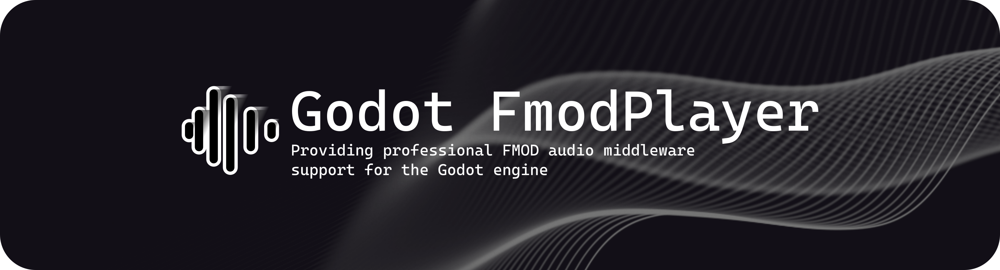
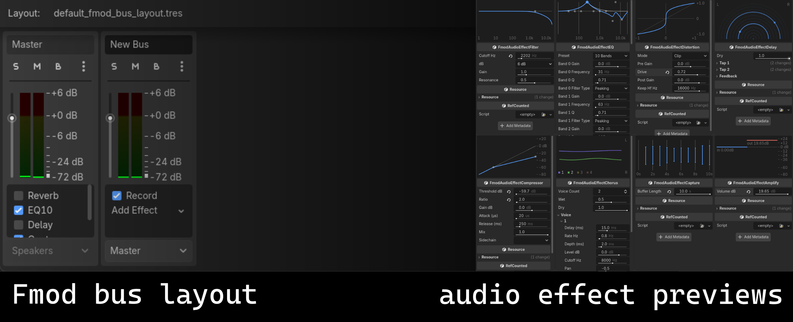
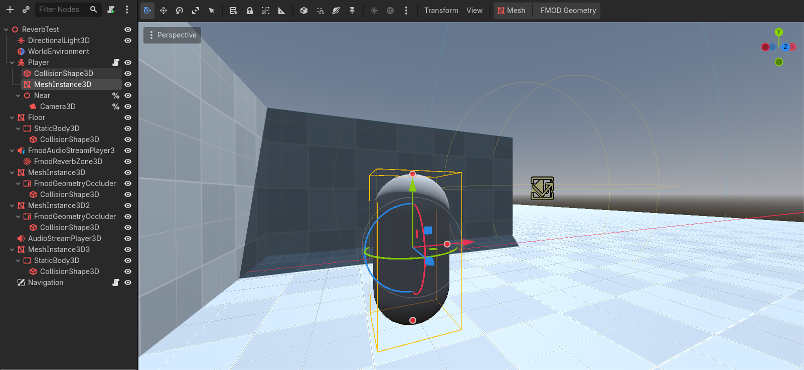

  

<h1 align="center">Godot-FmodPlayer</h1>

  <b>FMOD Core API playback, mixing, DSP, and 3D audio for Godot 4.</b>

  
  
  
  
  

## Features

### Mix and shape FMOD audio inside Godot

Build bus layouts in the FMOD Audio Dock, route buses freely, drag and drop effects, and tune parameters with interactive inspector previews, and optional sync with Godot's AudioServer.

### Build spatial audio into your scenes

Create sound occluders from collision shapes or meshes, place reverb zones, and configure distance attenuation and Doppler effects with dedicated nodes and editor gizmos.

## Quick Start

1. Install from the [Godot Asset Library](https://godotengine.org/asset-library/asset/4905) or copy `addons/fmod_player` from a [GitHub release](https://github.com/LuYingYiLong/Godot-FmodPlayer/releases) into your project.
2. On Windows, copy `api/core/lib/x64/fmod.dll` from the matching FMOD **2.04** [Core SDK](https://www.fmod.com/download) into `addons/fmod_player/bin`.
3. Enable **FMOD Player** under **Project > Project Settings > Plugins**.
4. Import audio as an FMOD audio resource, assign it to a player node, choose a bus, and enable `auto_play` or call `play()`.

## Platform Support

| Platform | Status |
|----------|--------|
| Windows x86_64 | Supported |
| Linux x86_64 | Tested on Ubuntu 26.04 |
| Android | arm64 builds; other ABIs available through SCons `arch` |
| macOS / iOS | Experimental; requires local SDK and linking setup |

## Documentation

[Setup guides, API reference, and examples...](https://godot-fmodplayerdocs.readthedocs.io/en/latest/)

## License

Godot-FmodPlayer uses the [MIT License](LICENSE.txt). FMOD is licensed separately by [Firelight Technologies](https://www.fmod.com); obtain an FMOD license for your project.
